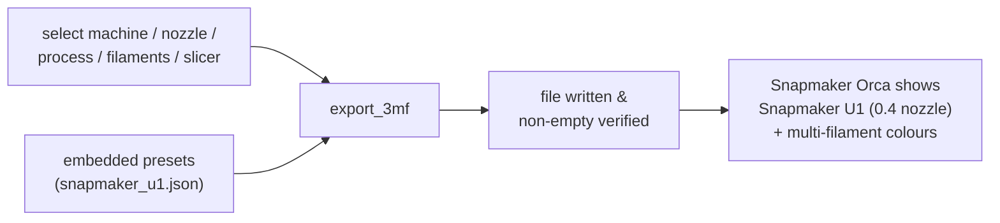

# Exporting

> Part of the CYM wiki — getting your coloured model into a slicer.
> Internals: [Technical: Export Pipeline](../technical/export-pipeline.md).

## Save a 3MF project

Use **File → Save** (Cmd/Ctrl+S) or the disk button to save your CYM project. After importing into a workspace without a saved project, the first save asks where to write a new 3MF. After that, Save updates the CYM file directly. Choose **Save As 3MF** to save a copy. Project files retain exact paint colors, brush color groups, regions and available undo/redo history. Use **Export** to choose printer and filament settings for slicing.

Saving retains the imported project's printer, process and material settings. Colours used by explicit process material references remain in the palette even when no painted face uses them. If source settings cannot be interpreted safely, saving reports an error and preserves the previous file; use **Export** to choose new settings explicitly. Source materials with identical RGB colours and explicit material references currently require this explicit export path.

Use the plate tabs above the viewport to switch plates. Double-click a tab to rename it, or use its × button to close it. Closing a dirty plate asks before discarding its edits. Each plate retains its own regions, hidden regions and undo/redo history. A mesh import adds a plate. Opening a 3MF replaces the whole project and asks first if any plate has unsaved edits. Closing the final plate clears the project and its save destination.

A successful whole-project 3MF export becomes the current project file. The next **Save** writes to that destination.

Save and Export use the exact path confirmed in the file dialog, preserving filename case and repeated suffixes without redirecting to another filename.

**Save and whole-project 3MF export include every open plate**, with one shared material palette and printer/process selection. The active plate, plate names, exact engineering colours and histories are restored when reopening the file. Clean inactive plates can be reloaded from their source on demand. Edited plates remain in memory in this release. A failed source load preserves the current plate and its edits.

A cancelled replacement or failed import keeps the current model and edits. Imports ask before replacing unsaved work. A complete new file is written before replacing an existing project, so an interrupted save preserves the previous version.

## Export 3MF (recommended)

The 3MF carries per-region colours **plus machine/process/filament metadata**, so the slicer shows a fully configured multi-material job.

The export dialog walks you through:

1. **Vendor & machine** — e.g. Snapmaker U1 (presets are embedded; no vendor profile installation needed)
2. **Nozzle diameter** — 0.2 / 0.4 / 0.6 / 0.8
3. **Process** — quality presets filtered for the machine + nozzle
4. **Filament slots** — one filament preset per palette slot, slot order preserved
5. **Target slicer** — Snapmaker Orca or OrcaSlicer (decides the model id written into the file)

Extras: palette slot preview before export, multi-region selection with **apply-all**, and your last selection is remembered (validated) between sessions.

**Verified end-to-end (2026-08-27)**: a real model exported from CYM imported into Snapmaker Orca (U1) with correct multi-filament colours and the embedded process preset (`0.20 Standard @Snapmaker U1 (0.4 nozzle)`) — see the [verification case](../cases/01-3mf-end-to-end.md).

**Saving oversized models:** Save / Save As preserves your editing work even when a model exceeds the selected printer's bed. Geometry and printer settings are retained. The explicit 3MF print-export command still checks bed fit; choose a suitable printer before preparing the printable file.

### Gradient paint to Snapmaker Orca

Choose **Snapmaker Orca** as the target for a project with gradient brush or fill paint. The filament list shows the physical spool colours used by the export. CYM assigns native, editable Gradient recipes to the painted surfaces. Each recipe uses a pair of physical filaments. If the model uses more colours than the printer has slots, the dialog shows that some colours will be approximated.

Snapmaker Orca 2.4.2 changes the mix from the lowest to the highest layer painted with each recipe. CYM fits the surface colours to that height range. Changes along a path on the same layer can only be approximated. A ramp with more than two colours uses successive two-filament Gradient recipes. Snapmaker Orca supports up to 64 physical and virtual slots combined. A print export that exceeds the limit stops before writing the file. Saving the CYM project keeps the editable ramps and reports any Gradient recipes it could not add to the print configuration.

**Save** keeps your exact CYM gradient. Saving a CYM Snapmaker gradient print export also preserves its physical spool palette and rebuilds its virtual slots. To choose a new spool palette, use **Export** again. OrcaSlicer export uses the regular flat colour palette.

### Models converted from textures

On the active texture plate, select the printer and assign the model colours to its physical filament slots. Several model colours may share a slot. Above 16 edited colours, the preview groups them into a palette of up to 16 rows for confirmation.

Mapped print export writes the active plate as a separate 3MF with its confirmed slot assignments. Use **Save** or **Save As 3MF** to preserve the entire workspace, including each plate's exact editable colours and confirmed texture mapping. You can reopen either file without the source GLB.

For a workspace containing textured plates, switch to the texture plate you want to print and export it with its confirmed slots. Ordinary whole-project print export uses a shared automatic palette.

## Exchange meshes with design tools

Use **File → Import Model** or drag a file onto CYM. To write the edited active plate, choose its format in **File → Export Model**. Save the workspace as 3MF to keep every plate, regions and editing history.

| Format | Import | Export |
|--------|--------|--------|
| STL | ASCII or binary triangles | Binary geometry |
| OBJ | Mesh with MTL diffuse colours and opacity, or vertex colours | OBJ with companion MTL, up to 256 RGBA materials |
| PLY | ASCII or binary mesh with face or vertex colours | Binary mesh with RGBA vertex colours |
| glTF / GLB | Static 2.0 triangle geometry with base colours and vertex colours. Keep local glTF buffers alongside the file. | Flat face colours, stored as vertex colours. Both exports are self-contained. |
| FBX | Static mesh from binary FBX | Binary FBX with mesh and colours |
| USD / USDA / USDC / USDZ | Static meshes with display colours or simple material colours | Mesh with display colours and opacity |

STL, OBJ and PLY have no standard unit declaration here. CYM reads and writes their coordinates in millimetres. glTF/GLB uses the standard metre and Y-up convention; FBX and USD use their scene units and axes.

FBX and USD require a separately installed Blender 4.5 or newer. CYM locates Blender in its usual installation locations or on PATH. Set `CYM_BLENDER` to the executable path to use a specific installation. These exchanges carry static triangles and flat colours. Rigs, animation, editable shaders and texture maps are outside this conversion.

Keep an OBJ next to its MTL when sharing it. OBJ export requires a `.obj` filename and picks a numbered MTL filename when the matching library already exists. The exported OBJ references the new library.

For a textured GLB, CYM offers a colour-baking preview. If the texture cannot be baked, the preview offers to import just the mesh and base colours. Vertex colours that vary across a triangle are reduced to one face colour.

On macOS, reading an MTL or glTF buffer from a protected folder such as Downloads may prompt for folder access.
