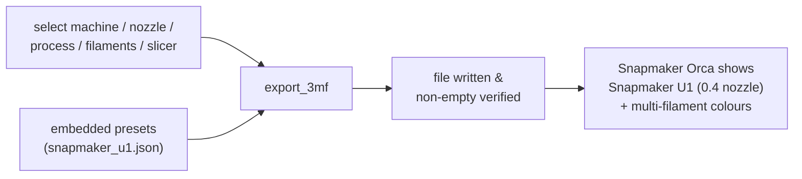

# Exporting

> Part of the CYM wiki — getting your coloured model into a slicer.
> Internals: [Technical: Export Pipeline](../technical/export-pipeline.md).

## Save a 3MF project

Use **File → Save** (Cmd/Ctrl+S) or the disk button to save your CYM project. For an external 3MF or STL, the first save asks where to write a new 3MF. After that, Save updates the CYM file directly. Choose **Save As 3MF** to save a copy. Project files retain exact paint colors, brush color groups, regions and available undo/redo history. Use **Export** to choose printer and filament settings for slicing.

Saving retains the imported project's printer, process and material settings. Colours used by explicit process material references remain in the palette even when no painted face uses them. If source settings cannot be interpreted safely, saving reports an error and preserves the previous file; use **Export** to choose new settings explicitly. Source materials with identical RGB colours and explicit material references currently require this explicit export path.

Use the plate tabs above the viewport to switch plates. Double-click a tab to rename it, or use its × button to close it; closing a dirty plate asks before discarding its edits. Each plate retains its own regions, hidden regions and undo/redo history. An STL import adds a plate. Opening a 3MF replaces the whole project and asks first if any plate has unsaved edits. Closing the final plate clears the project and its save destination.

A successful whole-project 3MF export becomes the current project file. The next **Save** writes to that destination.

Save and Export use the exact path confirmed in the file dialog, preserving filename case and repeated suffixes without redirecting to another filename.

**Save and whole-project 3MF export include every open plate**, with one shared material palette and printer/process selection. The active plate, plate names, exact engineering colours and histories are restored when reopening the file. Clean inactive plates can be reloaded from their source on demand. Edited plates remain in memory in this release. A failed source load preserves the current plate and its edits.

A cancelled replacement or failed import keeps the current model and edits. Imports ask before replacing unsaved work. A complete new file is written before replacing an existing project, so an interrupted save preserves the previous version.

## Export 3MF (recommended)

The 3MF carries per-region colours **plus machine/process/filament metadata**, so the slicer shows a fully configured multi-material job.

The export dialog walks you through:

1. **Vendor & machine** — e.g. Snapmaker U1 (presets are embedded; no vendor profile installation needed)
2. **Nozzle diameter** — 0.2 / 0.4 / 0.6 / 0.8
3. **Process** — quality presets filtered for the machine + nozzle
4. **Filament slots** — one filament preset per palette slot, slot order preserved
5. **Target slicer** — Snapmaker Orca or OrcaSlicer (decides the model id written into the file)

Extras: palette slot preview before export, multi-region selection with **apply-all**, and your last selection is remembered (validated) between sessions.

**Verified end-to-end (2026-08-27)**: a real model exported from CYM imported into Snapmaker Orca (U1) with correct multi-filament colours and the embedded process preset (`0.20 Standard @Snapmaker U1 (0.4 nozzle)`) — see the [verification case](../cases/01-3mf-end-to-end.md).

**Saving oversized models:** Save / Save As preserves your editing work even when a model exceeds the selected printer's bed. Geometry and printer settings are retained. The explicit 3MF print-export command still checks bed fit; choose a suitable printer before preparing the printable file.

### Models converted from textures

On the active texture plate, select the printer and assign the model colours to its physical filament slots. Several model colours may share a slot. Above 16 edited colours, the preview groups them into a palette of up to 16 rows for confirmation.

Mapped print export writes the active plate as a separate 3MF with its confirmed slot assignments. Use **Save** or **Save As 3MF** to preserve the entire workspace, including each plate's exact editable colours and confirmed texture mapping. You can reopen either file without the source GLB.

For a workspace containing textured plates, switch to the texture plate you want to print and export it with its confirmed slots. Ordinary whole-project print export uses a shared automatic palette.

## Export OBJ

Exports `.obj` plus a sibling `.mtl`: per-face colours become `usemtl` material groups, quantized to at most 256 colours. No machine/process pickers needed — colour is written directly. Use OBJ for tools that don't read 3MF (DCC software, viewers).

## Which one when?

| Target | Format |
|--------|--------|
| Slice & print (multi-material) | **3MF** |
| Blender / MeshLab / web viewers | **OBJ** |
| Sharing a printable job with presets | **3MF** |
