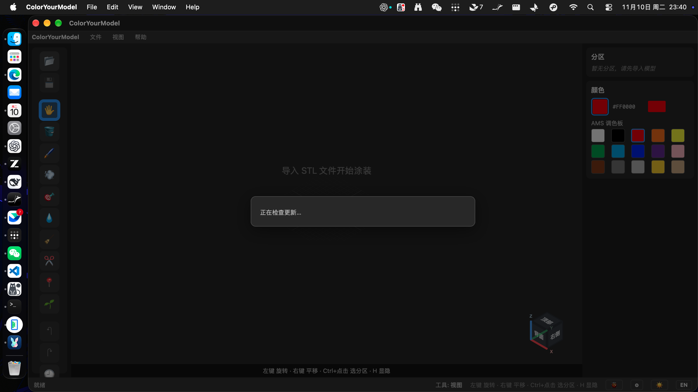
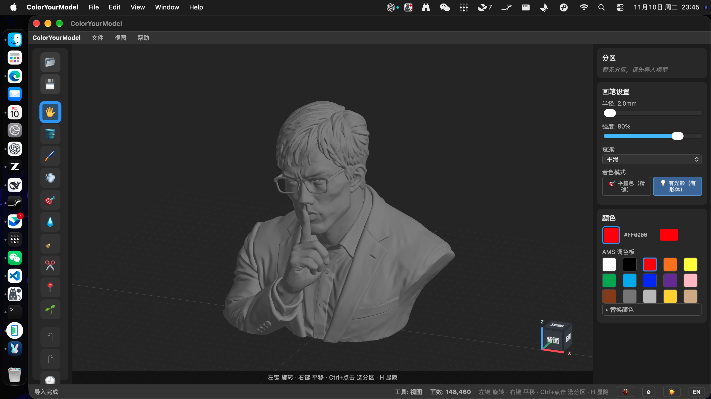
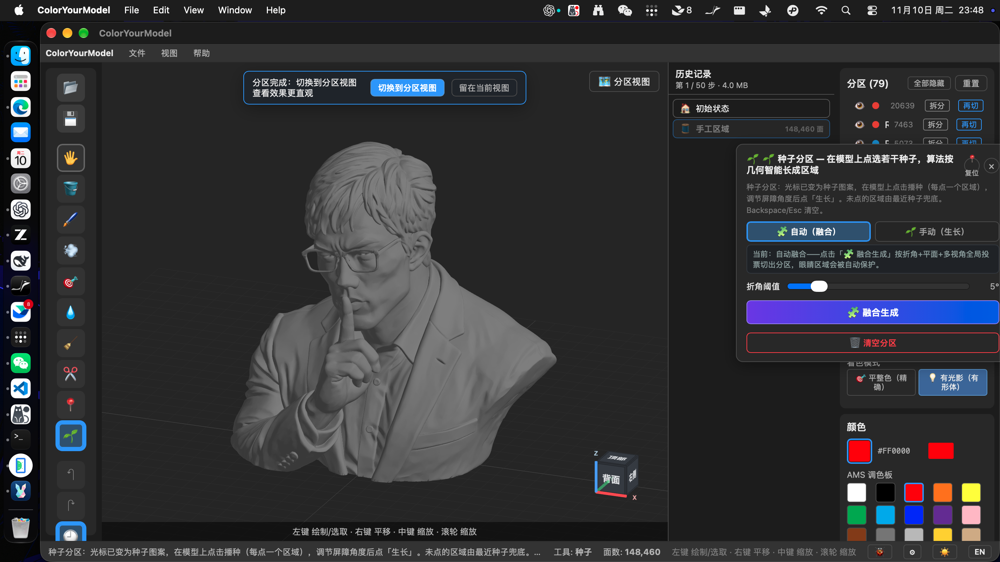
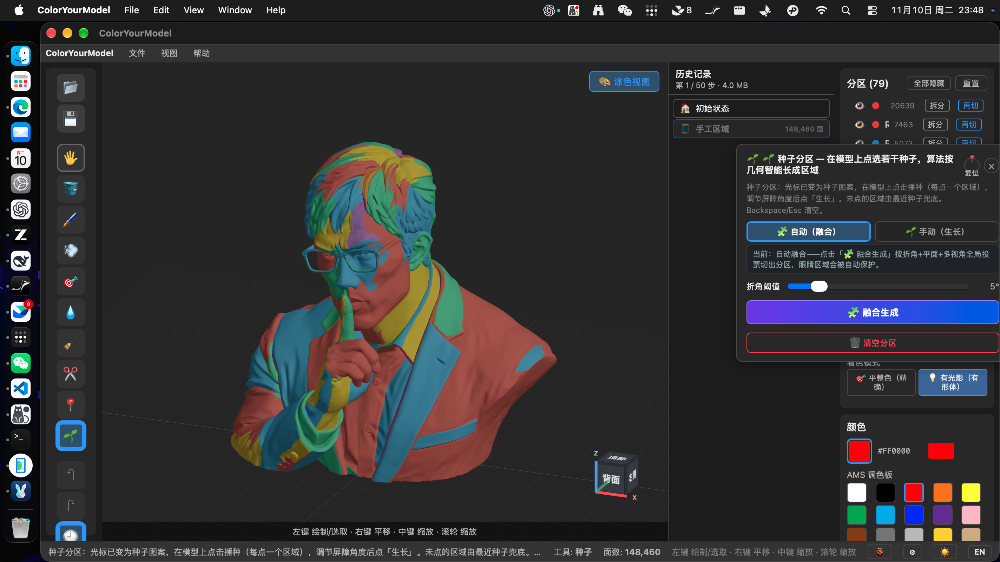
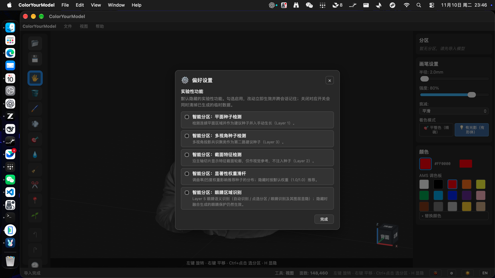
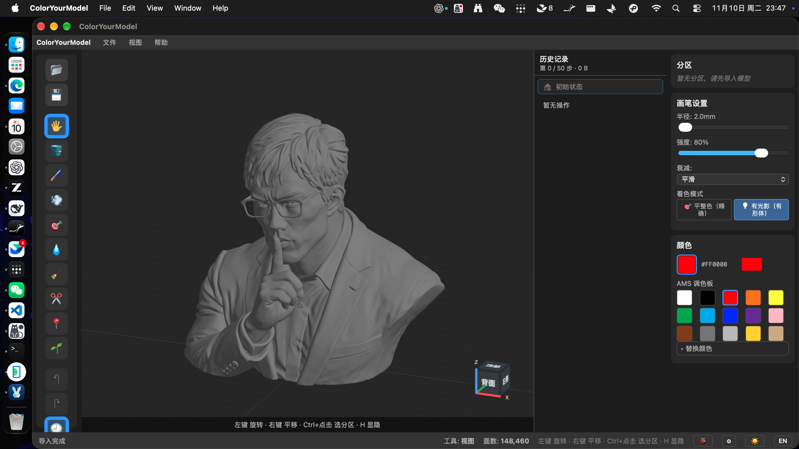
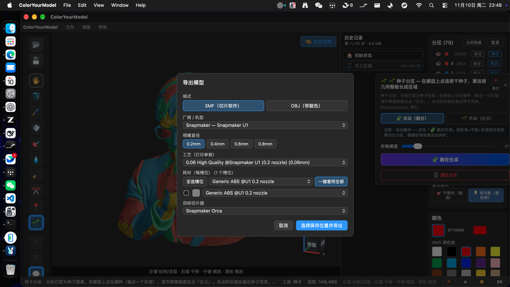

# ColorYourModel 0.1.2 发版验收报告

> 版本：0.1.2（自 0.1.1 之后的 36 个提交） ｜ 分支：`release/0.1.2` ｜ HEAD：`9c390b9`
> 验收日期：2026-11-10 ｜ 验收环境：macOS 27.0.1（Apple Silicon）· Node 24.20.0 · Rust 1.98.1 · Tauri CLI 2.11.4
> 验收方式：自动化测试 + release 构建 + 真实 GUI 验收（computer use：AppleScript CGEvent 驱动 + Vision OCR 校验 + 屏幕截图/录屏）

---

## 1. 结论速览

| 验收项 | 结果 | 证据 |
|---|---|---|
| TypeScript 类型检查 | ✅ 通过 | `npx tsc --noEmit` 0 错误 |
| 前端单元/组件测试 | ✅ 165/165 通过 | `npx vitest run`（22 个文件，0 失败） |
| Rust 后端测试 | ✅ 193 通过 / 0 失败 | `cargo test`（16 ignored） |
| release 打包构建 | ✅ 成功 | 产出 `ColorYourModel.app` + `ColorYourModel_0.1.1_aarch64.dmg` |
| GUI 冒烟：启动 | ✅ 通过 | 见 §4.1 |
| GUI：导入 STL | ✅ 通过（148,460 面） | 见 §4.2 |
| GUI：自动融合分区 | ✅ 通过（79 个分区） | 见 §4.3 |
| GUI：实验功能偏好 / 历史面板 / 导出对话框 | ✅ 通过 | 见 §4.4–4.6 |
| 提交原意审查 | ⚠️ 29 符合 / 5 部分 / 2 偏离 | 见 §5 |
| 发版完备性 | ⚠️ 需 5 项「发版前必须完成」 | 见 §6 |

**总体结论：功能层面验收通过（核心链路 启动→导入→分区→导出 全绿）。发版前仍需完成版本号提升、CHANGELOG 归位与 README/CI 更新等 5 项收尾（见 §6），其中 0 项为功能阻塞、均为发布工程收尾。**

---

## 2. 自动化测试结果（实测，非引用）

### 2.1 TypeScript

```
$ npx tsc --noEmit
（无输出，退出码 0）
```

### 2.2 前端 vitest

```
 Test Files  22 passed (22)
      Tests  165 passed (165)
   Duration  3.46s
```

> 2026-11-10 首轮验收时为 161/21 @ `9c390b9`；发版分支 rebase 到 `e39e1d8`（#38 带来 4 个新测试）后为 **165/22**，本节为发版分支实测。

### 2.3 后端 cargo test

```
test result: ok. 193 passed; 0 failed; 16 ignored; 0 measured; 0 filtered out
```

> 注：`npm run dev` 端口占用报错是因为本机已有一个 `vite`（PID 341）常驻在 1420，与本验收无关；测试均在独立 shell 内跑通。

---

## 3. release 构建结果

版本号提升到 0.1.2 后重新构建，产物命名同步为 `0.1.2`：

```
$ npm run tauri build
    Finished `release` profile [optimized] target(s) in 2m 37s
    Built application at: .../target/release/color-your-model
    Bundling ColorYourModel.app (.../bundle/macos/ColorYourModel.app)
    Bundling ColorYourModel_0.1.2_aarch64.dmg (.../bundle/dmg/ColorYourModel_0.1.2_aarch64.dmg)
    Finished 2 bundles (exit code 0)
```

- ✅ `.app` / `.dmg` 打包通过，文件名已随版本号变为 `0.1.2`。
- ⚠️ 编译期产生 **19 条 Rust dead-code 警告**（`metrics.rs` 的 `boundary_f_score`/`hamming_distance` 等未用函数），不阻塞构建，建议发版后清理（已在 commit-intent review 记为坏味道/清理项）。
- 首轮验收（2026-11-10 @ `9c390b9`，版本仍 0.1.1）的构建同样是 2 bundles / exit 0；本分支在此基础上完成版本号提升并复验。

---

## 4. GUI 验收（computer use，带截图）

> 验收用模型：`/Users/zackary/mnt/zackaree/selfDIr/3D_3mf/stls/梁圣.stl`（梁圣半身像，7.4 MB）。
> 驱动方式：AppleScript CGEvent 合成鼠标事件 + 键盘事件；每步用 `screencapture` 截图，再用 Vision OCR 校验界面文案/状态，确认成功后再进入下一步。

### 4.1 启动（空状态）

应用正常启动，界面含顶部菜单（文件/视图/帮助）、左侧工具栏、中央视口、右侧分区/颜色面板、底部状态栏。



OCR 校验：`导入 STL 文件开始涂装`、`工具：视图`、`暂无分区，请先导入模型`。

### 4.2 导入 STL

通过「文件 → 导入 STL…」→ 原生文件对话框（Cmd+Shift+G 定位目录）导入 `梁圣.stl`。状态栏出现「导入完成」，面数显示 **148,460**。



OCR 校验：`导入完成`、`面数：148,460`。

### 4.3 自动融合分区

激活「种子」工具（🌱）→ 点击「融合生成」，折角+平面+多视角+眼睛投票自动切出 **79 个分区**。



OCR 校验：`分区完成：切换到分区视图`、`分区 （79）`、`148,460面`。

切换分区视图后，模型以分区色显示：



### 4.4 实验性功能偏好（0.1.2 新增）

「帮助 → 偏好设置…」打开偏好对话框，展示 4 个实验性功能开关（平面/多视角/截面种子检测、显著性权重滑杆），默认全部未勾选。



### 4.5 历史记录面板（0.1.2 新增，#22）

「视图 → 历史记录」打开 Photoshop 式历史面板，当前显示「初始状态」。



### 4.6 导出对话框

「文件 → 导出涂装模型…」打开导出对话框：格式（3MF 切片软件 / OBJ 带颜色）、耗材每槽位、全选槽位、选择保存位置并导出。



> 说明：本验收打开并核验了导出对话框的完整选项；未实际落盘导出一个 3MF 文件（保存位置对话框需再交互，且后续导入 OrcaSlicer 的端到端切片验证建议在 Windows 实机用 EV 录屏完成，见 §7）。

### 4.7 演示视频

两版成片（真实 release 构建上的完整实操录屏，含念白与字幕）：

- 中文版（5:04）：[`videos/cym-demo-zh-1080p.mp4`](videos/cym-demo-zh-1080p.mp4)
- 英文版（4:38）：[`videos/cym-demo-en-1080p.mp4`](videos/cym-demo-en-1080p.mp4)

封面：[`cover-zh.png`](assets/cover-zh.png) · [`cover-en.png`](assets/cover-en.png)

---

## 5. 提交原意审查结论（36 个提交）

详见 [`0.1.2-commit-intent-review.md`](0.1.2-commit-intent-review.md)，汇总：

- **符合 29 / 部分 5 / 偏离 2**，每条结论有 `git log/show/diff`/grep 证据。
- 偏离（2）：`b98e869`、`df094b7` 两个 seed-erase 中间方案，机制已实现但修复思路被 round-9 取证证伪，且用了非规范 `bugfix:` 前缀（最终修复为 `2120cea` 屏幕空间方案）。
- 发版前必须处理（P0，见 commit-intent review §「发版前需清理项」）：
  1. CHANGELOG「多选统一」条目与代码不符（`pickedRegions` 不存在，实为 `mergePicked` + `viewSelectedRegions`）。
  2. CHANGELOG `#20` 空标题无正文。
  3. CHANGELOG 缺 `c7f5ab8` / `d20625d` 两个 012 提交条目，且 `[Unreleased]` 段残留 v0.1.1 之前的旧内容。

---

## 6. 发版前完备性检查结论

详见 [`0.1.2-release-readiness.md`](0.1.2-release-readiness.md)。**发版前必须完成（5 项）**：

| # | 项 | 现状 → 需改 |
|---|---|---|
| 1 | 版本号三处 | `package.json:4` / `tauri.conf.json:4` / `Cargo.toml:3` 均为 `0.1.1` → `0.1.2` |
| 2 | CHANGELOG | `[Unreleased]`(:41) → `[0.1.2] — <日期>`；修正排序；把 85–219 行混入的 2026-08/09 旧条目归位；补 `c7f5ab8`/`d20625d` 条目 |
| 3 | README ×2 | 徽章(:12)、下载链接(:42,46-48) 仍 v0.1.1 → v0.1.2；manual 标题同步 |
| 4 | release.yml | 默认 tag `v0.1.1`(:28) → `v0.1.2` |
| 5 | ci.yml | vitest 仍 `continue-on-error`(:4-7,33) 容忍 + CHANGELOG:35 仍记录已修复的 SeedPanel 3 失败 → 收紧门禁、删除失效 Known Issue |

> ✅ 上述 5 项已在发版分支 `release/0.1.2` 完成（版本号、CHANGELOG、README ×2、release.yml、ci.yml 均已更新，见本分支提交）。

**已通过项**：文档站同步（37 HTML/0 断链）、Tauri 能力 ACL、打包配置（图标/identifier/targets）、自动更新命名约定、CI 存在 tsc+vitest+cargo 硬门禁、LICENSE/SECURITY/CODE_OF_CONDUCT、`npm audit --omit=dev` 0 生产漏洞。

**建议项**：.gitignore 已增加 `demo-video/` 本地工作区规则与 `*.mp4/*.mov` 二进制标记；剩余打磨项：清理 19 条 Rust dead-code 警告与 `src/main.tsx:20-38` 的 `[freeze-diag]` rAF 心跳探针；评估 `tools/seed-erase-forensics*`（1.3 MB）与根目录误提交的 `.git-commit-msg-28.txt` 是否纳入 release 资产。

---

## 7. 验收局限与补充建议

1. **未完成的实机环节**：本验收用 CGEvent 合成事件 + OCR 校验完成了「启动→导入→分区→导出对话框」链路；但「画笔在 3D 模型上实际涂抹」「导出的 3MF 在 Snapmaker Orca / OrcaSlicer 中回读切片」两步未在本机端到端跑通（画笔落点依赖盲坐标点击、切片器回读需另启 GUI）。建议在 Windows 实机（配 EV 录屏）补充这两步的录屏证据。
2. **截图为本机截屏**，视觉细节请以 `docs/release/assets/*.png` 为准；本报告中的文字状态均来自 OCR 校验，非像素级人工核对。
3. **演示视频**已在真实 release 构建上完成（中文 5:04 / 英文 4:38，见 §4.7 与 [`0.1.2-release-note.md`](0.1.2-release-note.md)），覆盖导入 → 融合 → 生长 → 补切 → 上色 → 导出 → Orca 切片全链路。

---

## 8. 交付物清单

| 文件 | 说明 |
|---|---|
| [`0.1.2-commit-intent-review.md`](0.1.2-commit-intent-review.md) | 36 提交原意审查 |
| [`0.1.2-test-cases.md`](0.1.2-test-cases.md) | 95 条测试用例 + 自动化覆盖映射 + 验收清单 |
| [`0.1.2-release-readiness.md`](0.1.2-release-readiness.md) | 发版前完备性检查（11 项） |
| [`0.1.2-release-note.md`](0.1.2-release-note.md) | Release Note（英文前 / 中文后） |
| [`assets/01…07-*.png`](assets/) | 7 张验收截图 |
| [`videos/cym-demo-zh-1080p.mp4`](videos/cym-demo-zh-1080p.mp4) | 中文演示视频（5:04） |
| [`videos/cym-demo-en-1080p.mp4`](videos/cym-demo-en-1080p.mp4) | English demo video (4:38) |
