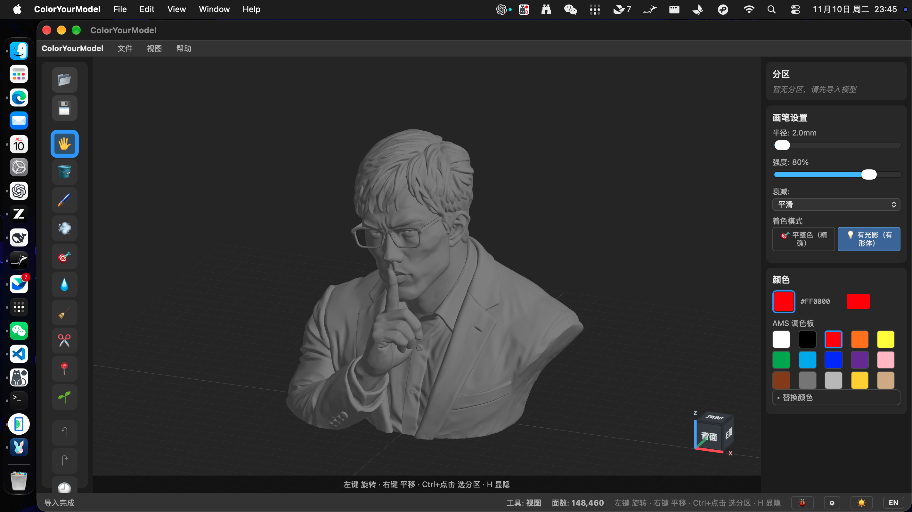
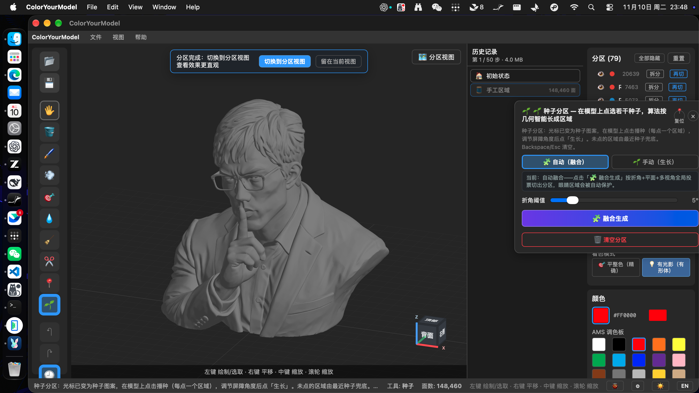
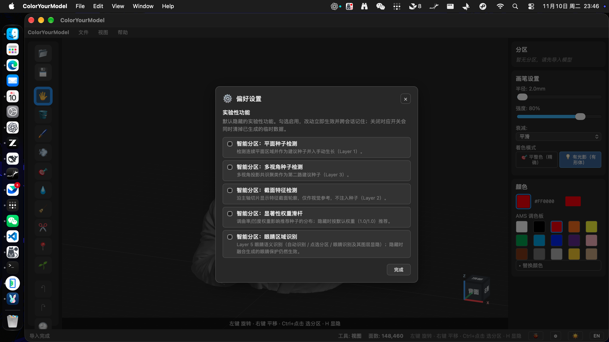
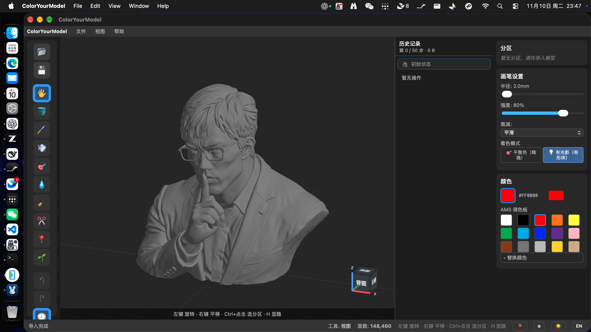
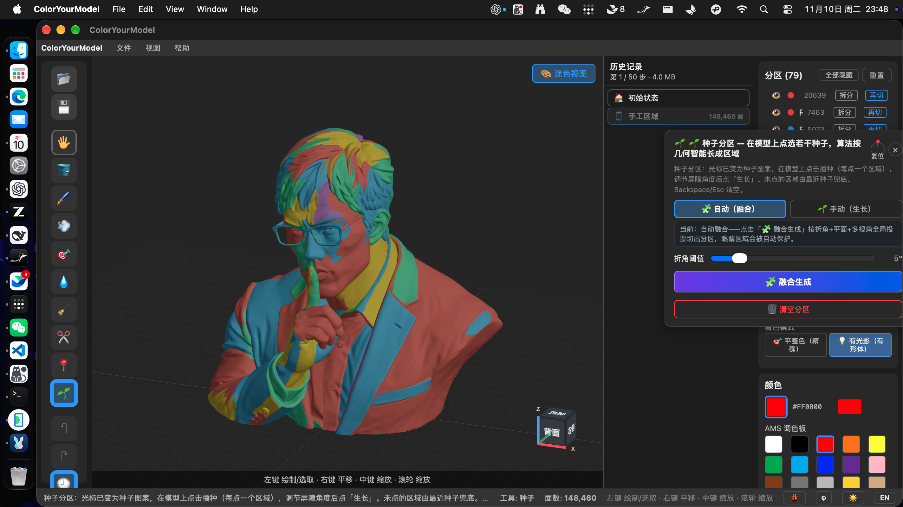
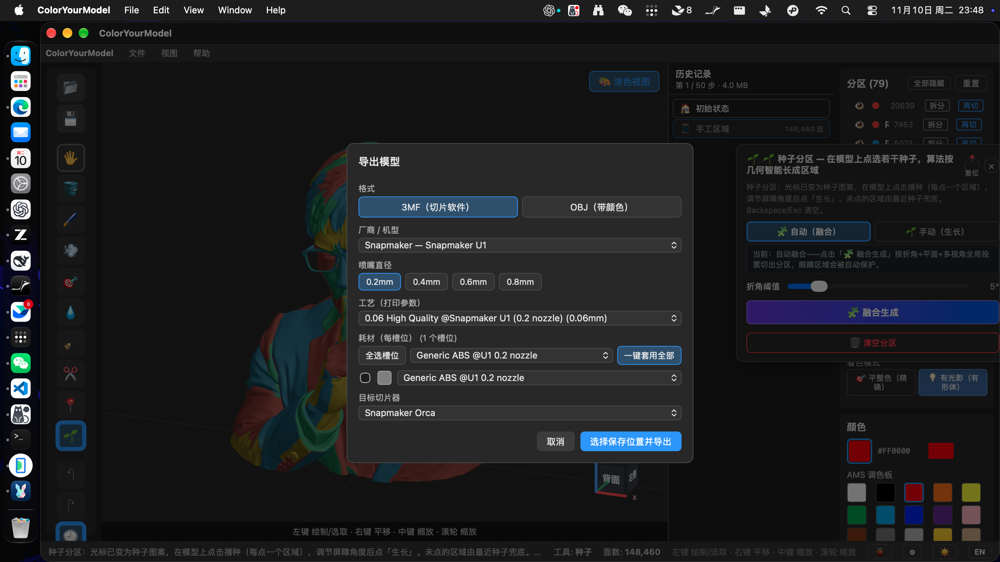

# ColorYourModel 0.1.2

> **Demo video / 演示视频:** [中文 5:04](videos/cym-demo-zh-1080p.mp4) · [English 4:38](videos/cym-demo-en-1080p.mp4)
> **Feature screenshots / 功能截图:** [jump to gallery / 跳到图库](#feature-screenshots--功能截图)

---

## Highlights

- **A complete painting & segmentation workflow** — drag-and-drop STL import, a Photoshop-style history panel with one-click jump, per-region visibility toggles, a used-colours picker, and one-click colour find-and-replace.
- **Multi-select everywhere** — Ctrl/Cmd+click regions on the model or in the panel to batch-hide, batch-fill, or merge them in a single undo step.
- **No more silent data loss** — clearing or resetting partitions now asks for in-app confirmation, and brushes can no longer paint through hidden regions.
- **Experimental features behind opt-in gates** — a new Preferences dialog keeps the default UI on the mature path while advanced detection options can be enabled per feature.
- **Seed & paint correctness** — the seed eraser finally hits its target at any zoom and angle, sowing lands on the face centroid, and paint-source colours let you repaint a whole stroke.

## Demo video

Two cuts, same walkthrough, recorded on the real release build over a **148,460-face** bust:

| | Video | Length | Cover |
|---|---|---|---|
| 中文 | [`cym-demo-zh-1080p.mp4`](videos/cym-demo-zh-1080p.mp4) | 5:04 | [`cover-zh.png`](assets/cover-zh.png) |
| English | [`cym-demo-en-1080p.mp4`](videos/cym-demo-en-1080p.mp4) | 4:38 | [`cover-en.png`](assets/cover-en.png) |

ColorYourModel turns a plain STL into a multi-colour 3MF: cut the model into meaningful parts, colour the parts, export a 3MF that a slicer reads as filament assignments. The walkthrough runs the whole loop — import, auto fuse, manual grow, partition brush / lasso fix-ups, fills, smart-pen detail, 3MF export, and a slice in Orca. Real screen recording, including the parts that are still rough.

## Feature screenshots / 功能截图

| | |
|---|---|
|  |  |
| **Import** — drop/choose an STL, the status bar reports face count and "Import complete". | **Auto fuse** — planar + multiview + dihedral + eye vote cuts the model into regions. |
|  |  |
| **Experimental features** — per-feature gates, all off by default. | **History panel** — every applied step, click any row to jump. |
|  |  |
| **Segment view** — regions tinted per part, toggle back to paint view. | **Export** — 3MF for slicers / OBJ with colours, filament slot mapping. |

## Added

- **Experimental-features preferences** — a new Preferences dialog (⚙ in the status bar and the Help menu) gates the smart-partition extras behind per-feature switches: planar / multiview / cross-section seed detection, seed weight sliders, and eye detection. All default to **off**, so the default UI keeps only the mature path.
- **Drag-and-drop STL import** (#21) — drop an `.stl` or `.cym` file anywhere on the window to import it through the same pipeline as the 📂 button.
- **History panel** (#22) — View → History opens a dockable panel listing every applied step; click any row to jump straight to that state in one IPC call.
- **Used colours** (#23) — the colour panel now lists the colours actually on the model, ordered by usage; hover shows `#hex · faces · regions` and outlines the matching regions.
- **Per-region visibility** (#24) — every partition row gains a 👁 toggle (hide/show, show-all/hide-all, Alt+click to isolate); hidden regions are excluded from picking/painting but still export as usual.
- **Replace colour** (#29) — swaps every region using one colour for another in a single undo step, with a live dry-run count and guards.
- **Paint-source colours** — the colour panel groups the exact colours you painted with (brush / spray / smart brush), separate from the blended result.
- **Import-failure dialog** — a broken or unsupported file now shows a modal dialog with the raw backend error instead of a blink-and-miss status line.
- **Ctrl+click multi-select** — view / fill tools and panel rows share one selection: "N regions selected" card offers merge-into-first and fill-these (one IPC, exactly one undo step).

## Changed

- **Seed UX** — seed sowing gets a seed-shaped cursor (manual mode only), the eraser is relabelled "Enable seed eraser", markers are 33% larger and land on the clicked face's centroid, and erase tolerance covers a full marker height.
- **Default region names localise on display** (#38) — the backend stores language-neutral `Region N`; the UI now renders `分区 N` in Chinese while user renames pass through verbatim.

## Fixed

- **Seed eraser cross-coordinate bug** — seeds are model-local while the camera/rays are world-space; the eraser now converts local → world → screen before a zoom-aware pixel-distance match.
- **Seed sowing drift** — the centroid formula indexed the flat vertex arrays incorrectly.
- **Destructive reset confirmation** — clearing/resetting partitions used `window.confirm`, which Tauri's dialog plugin turned into an always-truthy Promise; an in-app confirmation dialog now guards it.
- **No painting on hidden regions** — hidden labels are now culled at commit time, so brush/spray/eraser can no longer implicitly paint hidden partitions.
- **Whole-stroke undo** — one brush drag now coalesces into a single undo entry.
- **Import crash on large-offset models** — the kd-tree tie-breaker jitter is now scale-aware and kd-tree builds are panic-guarded with a linear-scan fallback.
- **Merge pick dead in the View tool** (#16) — Ctrl+click multi-select now wins in the default tool while plain drag still orbits.
- **Viewport gizmo textures going black** — focus and tab-visibility changes now force a texture rebuild.
- **Used-colours noise** — one brush drag blended hundreds of near-identical colours; entries are now condensed into RGB buckets.

## Known Issues

- Very large models (millions of faces) may time out during the fusion vote phase — `MAX_AUTO_REGIONS` is not yet wired into the vote path.
- macOS packages are unsigned and not notarized; if Gatekeeper blocks first launch, run `xattr -cr /Applications/ColorYourModel.app`.
- One-click auto-update install is currently Windows-only; macOS and Linux are directed to the release page.

## Upgrading & Installation

- Download the installer for your platform from GitHub Releases.
- **Windows:** auto-update checks silently on startup (once per session); the one-click updater streams the download, verifies the size and installs passively with an automatic restart.
- **macOS / Linux:** the updater directs you to the release page to download the new build manually.
- Upgrading from 0.1.1 keeps your preferences (language, theme, experimental-feature gates and export presets).

---

## 核心亮点

- **完整的涂装与分区工作流** —— 拖拽 STL 导入、Photoshop 式历史面板（一键跳转）、分区逐项显隐、已用颜色取回、一键颜色查找替换。
- **贯穿全局的多选** —— 在模型或分区面板上 Ctrl/Cmd+点击即可批量隐藏、批量填充或合并分区，一步撤销。
- **不再静默丢失数据** —— 清空/重置分区现在需要应用内确认；画笔也无法再涂到隐藏分区上。
- **实验性功能走偏好开关** —— 新增偏好设置对话框，默认只保留成熟路径，高级检测等可选项按功能逐项开启。
- **种子与涂装正确性** —— 种子橡皮擦在任意缩放/角度下终于能命中目标，播种落在面质心，涂装来源色支持整笔重涂。

## 演示视频

两版成片，同一套流程，均在 **148,460 面** 胸像的真实 release 构建上录屏：

| | 视频 | 时长 | 封面 |
|---|---|---|---|
| 中文 | [`cym-demo-zh-1080p.mp4`](videos/cym-demo-zh-1080p.mp4) | 5:04 | [`cover-zh.png`](assets/cover-zh.png) |
| English | [`cym-demo-en-1080p.mp4`](videos/cym-demo-en-1080p.mp4) | 4:38 | [`cover-en.png`](assets/cover-en.png) |

ColorYourModel 是一个把白模 STL 变成多色 3MF 的工具：先把模型切成有意义的区块，再按区块上色，导出成切片软件认得的 3MF，直接对应耗材槽位。这条视频用一个 14.8 万面的胸像完整走了一遍：导入 → 自动融合 → 手动生长 → 分区画笔 / 套索补切 → 填充上色 → 智能笔修细节 → 导出 3MF → 在 Orca 里切片验证。全程真机录屏，包括它现在做不好的地方。

## 功能截图

| | |
|---|---|
|  |  |
| **导入** —— 拖入/选择 STL，状态栏报面数与「导入完成」。 | **自动融合** —— 平面 + 多视角 + 折角 + 眼睛投票切出分区。 |
|  |  |
| **实验功能偏好** —— 逐项开关，默认全关。 | **历史记录** —— 每步一列，点任意行直接跳到该状态。 |
|  |  |
| **分区视图** —— 分区按件着色，可切回涂装视图。 | **导出** —— 3MF（切片软件）/ OBJ（带颜色），耗材槽位映射。 |

## 新增

- **实验性功能偏好** —— 新增偏好设置对话框（状态栏 ⚙ 与「帮助」菜单均有入口），把智能分区增强项收进逐项开关：平面 / 多视角 / 截面种子检测、种子权重滑条、眼睛检测。所有开关默认**关闭**，默认界面只保留成熟路径。
- **拖拽 STL 导入**（#21）—— 把 `.stl`/`.cym` 文件拖到窗口任意位置即可走与 📂 按钮同一条导入管线；悬停时有虚线高亮与「松开以导入」提示，替换已加载模型前先弹窗确认。
- **历史记录面板**（#22）—— 「视图 → 历史记录」打开可停靠面板，逐行列出每一步操作，点击任意一行即一次 IPC 跳转。
- **已用颜色**（#23）—— 颜色面板列出模型上实际用到的颜色（按用量排序），悬停显示 `#色号 · 面数 · 区域数` 并描边高亮，点击设为当前颜色。
- **分区显隐**（#24）—— 每个分区行新增 👁 开关（隐藏/显示、全部显示/隐藏、Alt+点击隔离）；隐藏分区被排除在拾取/涂色之外，但照常导出。
- **替换颜色**（#29）—— 查找替换区把「用了某个颜色的所有区域」一步换为另一颜色，仅一条撤销记录，应用前实时 dry-run 计数。
- **涂装来源色（绘制颜色）** —— 颜色面板按组列出你实际涂色时用的颜色（画笔 / 喷涂 / 智能笔刷），与混合结果区分开。
- **导入失败弹窗** —— 损坏或不支持的文件现在弹出模态对话框展示原始后端错误。
- **Ctrl+点击多选** —— 查看 / 填充工具与分区面板行共用一套多选，「已选 N 个分区」卡片提供合并到首个选中与填充这些分区（一次 IPC、恰好一条撤销记录）。

## 变更

- **种子交互体验** —— 播种改为种子形光标（仅手动模式）、擦除模式改名「启用种子擦除」、标记放大 33% 且落在点击面的质心、擦除容差覆盖整个标记高度。
- **默认分区名展示本地化**（#38）—— 后端存语言中立的 `Region N`，中文界面展示为「分区 N」，用户重命名过的名字原样保留。

## 修复

- **种子橡皮擦跨坐标系 bug** —— 种子是模型局部坐标、相机/射线是世界坐标，此前直接比较致误差随模型尺度变化；现统一「局部 → 世界 → 屏幕」后再做像素距离匹配。
- **播种漂移** —— 质心公式索引扁平顶点数组时下标写错。
- **破坏性重置确认** —— 清空/重置分区原先用 `window.confirm` 守卫，被 Tauri 对话框插件接管成恒为 truthy 的 Promise；现改为应用内确认对话框。
- **不再涂到隐藏分区** —— 提交前按隐藏标签剔除，隐藏分区无法被隐式涂改。
- **画笔整笔撤销** —— 一次拖拽合并为一条撤销记录。
- **大偏移模型导入崩溃** —— kd 树平局扰动改为随量级自适应，kd 树构建带 panic 守卫并降级为线性扫描兜底。
- **查看工具下多选失效**（#16）—— 多选分支优先于查看工具提前返回，默认工具下也生效。
- **视口 gizmo 纹理发黑** —— 窗口聚焦 / 标签页可见性变化会强制重建纹理。
- **已用颜色噪声** —— 压缩为 RGB 桶聚合（替换颜色的精确匹配契约不变）。

## 已知问题

- 超大模型（数百万面）在融合投票阶段可能超时——`MAX_AUTO_REGIONS` 尚未接入投票路径。
- macOS 包未签名/未公证：首启被 Gatekeeper 拦截时执行 `xattr -cr /Applications/ColorYourModel.app`。
- 自动更新一键安装目前仅限 Windows；macOS / Linux 会跳转发布页手动下载。

## 升级与安装

- 从 GitHub Releases 下载对应平台的安装包。
- **Windows：** 启动后静默检查更新（每会话一次）；一键更新器流式下载、校验大小并被动安装后自动重启。
- **macOS / Linux：** 更新器会引导你跳转发布页手动下载新版本。
- 从 0.1.1 升级会保留你的偏好（语言、主题、实验性功能开关与导出预设）。
